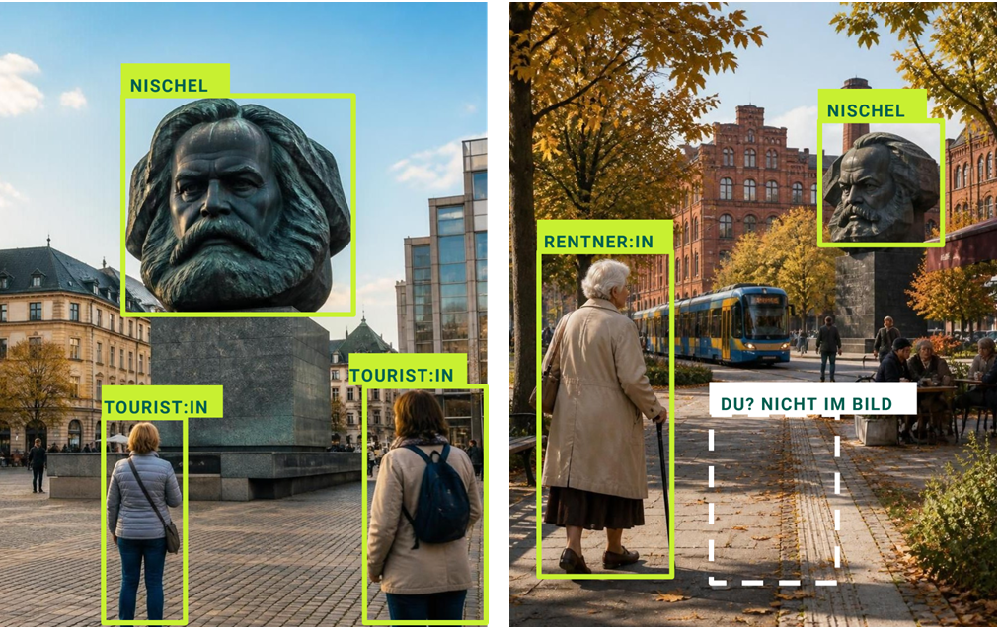

<!--
HINWEISE ZUM BEARBEITEN (dieser Kommentar ist auf der Webseite und auf GitHub unsichtbar)

Überschriften:   # Titel   ## Abschnitt   ### Unterabschnitt   → erscheinen automatisch im Menü
Link:            [Linktext](https://…)
Bild:            
Bildnachweis:    in der Zeile direkt unter dem Bild, nach einer Leerzeile:  _Foto: …_
                 → wird klein, grau und rechtsbündig angezeigt
Bild mit Label:  
                 → Bild bekommt einen Erkennungsrahmen mit dem Label „Hinterhof“, wie auf dem Plakat
Galerie:         mehrere Bilder in direkt aufeinanderfolgenden Zeilen, OHNE Leerzeile dazwischen

Vor dem Hochladen: Bilder auf max. ca. 1600 px Breite verkleinern, Metadaten (GPS) entfernen,
keine Fotos mit erkennbaren Personen. Dateinamen ohne Leerzeichen und Umlaute (z. B. hinterhof-01.jpg).
-->

# Wessen Stadtbild?

**Jugendliche trainieren KI mit ihren Perspektiven**

_Bilder: KI-generiert (GPT-6, duck.ai), 8.10.26. Prompts: „Zeige die Stadt Chemnitz aus der Perspektive eines Touristen“ und „… einer Rentner:in“._

Künstliche Intelligenz prägt nicht nur zunehmend, wie Städte, Orte und Menschen wahrgenommen werden. Vielmehr interagieren Jugendliche in ihrem Alltag verstärkt mit KI-Chatbots und begegnen in Social Media immer mehr KI-generierten Inhalten. Doch die den KI-Modellen zugrunde liegenden Trainingsdaten bilden nur bestimmte Perspektiven ab, sodass Biases und Stereotypen den Output bestimmen.

Das Projekt erschließt künstlerische und kreative Zugänge zu KI, die zu einer kritischen Reflexion einladen und die digitale Selbstwirksamkeit fördern. In einem vierstündigen Workshop experimentieren Jugendliche selbst mit eigenen Bild- und Textbeobachtungen aus ihrem Alltag in Chemnitz. Die „alternative“ KI-Trainingsdaten sowie die Outputs werden in Form einer digitalen Ausstellung präsentiert. Ziel des Projekts ist es, Jugendliche und ihre Alltagserfahrungen vor dem Hintergrund der rasanten Entwicklung von KI in den Mittelpunkt zu rücken

## Der Workshop: Zeig der KI dein Chemnitz!

Im Workshop analysieren wir KI-generierte Bilder von Chemnitz, dokumentieren das Viertel rund ums AJZ fotografisch und trainieren daraus ein eigenes Bildklassifikationsmodell. Die Jugendlichen entscheiden dabei selbst: Sie wählen die Orte, die fotografiert werden, bestimmen, welche Beobachtungen wichtig sind, und handeln in Kleingruppen die Kategorien aus, mit denen das Modell trainiert wird.

- **Wann:** Dienstag, 24. November 2026, 14–18 Uhr
- **Wo:** AJZ Chemnitz, Chemnitztalstraße 54, 09114 Chemnitz
- **Für wen:** Jugendliche und junge Erwachsene von 14 bis 20 Jahren, kostenlos, keine Vorkenntnisse nötig

**Anmeldung** bis [23.11.2026] über Instagram [_ajz_chemnitz_projekte_] oder per E-Mail an [jugendclub@ajz.de](mailto:jugendclub@ajz.de).

## Projekt

„Wessen Stadtbild?“ ist eine Kooperation des Alternativen Jugendzentrums (AJZ) Chemnitz und der [Juniorprofessur für Digital Humanities](https://www.tu-chemnitz.de/phil/ifgk/dh/index.html) an der Philosophischen Fakultät der TU Chemnitz. Das Projekt wird von Jun.-Prof. Dr. Rabea Kleymann gemeinsam mit dem pädagogischen Team des AJZ durchgeführt. Projektzeitraum ist Oktober bis Dezember 2026.

Gefördert durch den Jugendkulturfonds der Stadt Chemnitz.

## Kontakt

Fragen zur Anmeldung beantwortet das Team des AJZ unter [jugendclub@ajz.de](mailto:jugendclub@ajz.de). Fragen oder Anregungen zum Projekt nimmt das Team der Juniorprofessur für Digital Humanities gern entgegen [rabea.kleymann@phil.tu-chemnitz.de] (mailto: rabea.kleymann@phil.tu-chemnitz.de).

## Impressum 

Technische Universität Chemnitz
Juniorprofessur Digital Humanities
09107 Chemnitz 

